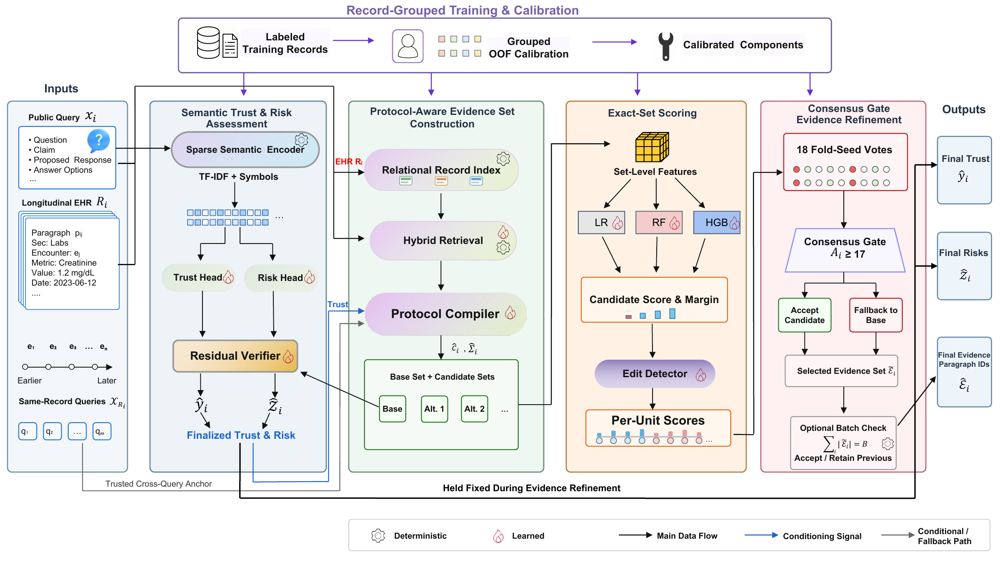

# MedVERA

**Protocol-Aware Exact-Set Evidence Grounding for Trustworthiness Verification over Longitudinal EHRs**

MedVERA is a four-module, fully local framework for trustworthiness
verification over longitudinal electronic health records. It combines
protocol-aware exact-set evidence grounding with joint prediction of trust
labels, clinical risk types, and evidence paragraph IDs, without external
generative APIs. This repository provides raw-data training and frozen
inference artifacts for the Track 1 Silver Award project, whose competition
submission tied for the top final Codabench score of **100.0**.

- Codabench competition: <https://www.codabench.org/competitions/16891/>
- Workshop and challenge: <https://trustworthy-agentic-ai.github.io/>
- External generative API usage: **none**
- Generative token usage: **0**

## Award

🏆 **Silver Award — Track 1: MedLongTrust-EHR**

MedVERA received the Silver Award at **Trustworthy Agentic AI 2026**, held
in conjunction with **UbiComp/ISWC 2026**. The official certificate recognizes
the paper *MedVERA: Protocol-Aware Exact-Set Evidence Grounding for
Trustworthiness Verification over Longitudinal EHRs*.

- **Authors:** Ai Tang, Wei Yuan, Fuyou Zhang
- **Institution:** Chongqing University of Posts and Telecommunications
- **Award date:** 12 October 2026
- **Final Codabench score:** 100.0, tied for the top score on the final leaderboard

<p align="center">
  <a href="Track%201%20Silver%20Award.pdf">
    
  </a>
</p>

<p align="center">
  <a href="Track%201%20Silver%20Award.pdf">View or download the official certificate (PDF)</a>
</p>



## Method

The implementation follows the four modules described in the paper:

1. **Semantic trust and risk assessment** uses public-query TF-IDF features,
   class-balanced trust/risk classifiers, and conservative grounded residual
   verification.
2. **Protocol-aware evidence-set construction** combines a relational EHR
   index, hybrid paragraph retrieval, paragraph roles, and family-specific
   count-and-role protocols.
3. **Exact-set candidate scoring and edit detection** compares complete
   evidence sets using logistic regression, random forest, and histogram
   gradient boosting, while a separate detector estimates whether the current
   set should be edited.
4. **Consensus-gated evidence refinement** accepts a protocol-complete edit
   only with at least 17 supporting votes from 18 record-grouped fold-seed
   units, otherwise retaining the base evidence set.

## Installation

MedVERA supports Python 3.10-3.12. The exact frozen reproduction path uses
only the Python standard library:

```bash
python3 -m venv .venv
source .venv/bin/activate
python -m pip install -e .
```

Install the optional machine-learning dependencies when training or
inspecting the learned components:

```bash
python -m pip install -e ".[train]"
```

The competition environment used joblib 1.1.1 with a system-provided
distutils compatibility layer. The public training extra pins joblib 1.3.2
so that a clean Python 3.12 environment works without that hidden system
dependency; this does not change the trained estimators or predictions.

## Data

The official dataset is not duplicated in this repository. Download the
public release from the competition and place it in a directory with this
layout:

```text
MedLongTrust-EHR/
  train/
    questions.jsonl
    records.jsonl
    answers.json
  dev/
    questions.jsonl
    records.jsonl
    answers.json
  test/
    questions.jsonl
    records.jsonl
```

The audited release contains 1,167 questions / 84 records for train, 265 /
18 for dev, and 266 / 18 for test. Different counts usually indicate a
different release and may not reproduce the reported hashes.

Training reads the annotations in `train/questions.jsonl` and the EHR text in
`train/records.jsonl`. Prediction reads only public query fields and record
text. Pass the dataset directory with `--data-dir` or set
`MEDVERA_DATA_DIR`. Do not commit downloaded data, organizer-private
references, or test gold files to this repository.

## Train from Raw Data

Fit all learned components, serialize the model bundle, and optionally
evaluate it on dev after fitting:

```bash
medvera-train \
  --data-dir /path/to/MedLongTrust-EHR \
  --model-dir models/medvera \
  --evaluate-dev
```

This command trains the TF-IDF trust/risk models, structured semantic
calibrator, supervised paragraph ranker, current-set edit detector, and 18
record-grouped exact-set units. Each set unit contains logistic-regression,
random-forest, and histogram-gradient-boosting scorers.

The output directory contains `model.joblib` and `training_report.json`.
With `--evaluate-dev`, it also contains `dev_predictions.json`. Dev is loaded
only after fitting and never updates model parameters. In our clean
verification against the supplied release, training on 1,167 train questions
and evaluating on 265 held-out dev questions gave 1.0 trust accuracy, 1.0 risk
micro-F1, 1.0 evidence F1, and a 100.0 FinalScore.

The reference implementation is CPU-only and does not require a GPU or a
generative API. A clean Python 3.12 audit completed full training and dev
evaluation in approximately 90 seconds and produced a 1.1 MB model bundle;
runtime varies with hardware.

Use `medvera-train --help` to change the global random state, grouped seeds,
fold count, consensus requirement, or paragraph-candidate limit.

Run an independently trained model on dev or test:

```bash
medvera-predict \
  --data-dir /path/to/MedLongTrust-EHR \
  --model-dir models/medvera \
  --split test \
  --output outputs/submission.json
```

For a scored development prediction, use `--split dev --evaluate`. Test
prediction produces the required zero-valued token summary together with
`trust_label`, `risk_types`, and `evidence` for every query.

## Exact Reproduction

The trainable path is intended for retraining and method development. The
separate frozen path preserves the historical competition output
byte-for-byte. Reproduce both development and test predictions:

```bash
medvera-reproduce \
  --data-dir /path/to/MedLongTrust-EHR \
  --split all \
  --output-dir outputs \
  --verify-hash
```

Run the full integrity, schema, hash, and development-score audit:

```bash
medvera-verify \
  --data-dir /path/to/MedLongTrust-EHR \
  --output-dir outputs/verified
```

Expected test submission SHA256:

```text
7ed85f5c47aad1b3e9f28abf89a044353b386cfc873d1ac4b8faf7d49f5e6daa
```

The generated file is `outputs/submission.json`. It contains all required
`trust_label`, `risk_types`, and `evidence` fields together with zero-valued
token statistics.

## Reproducibility Scope

The repository exposes two deliberately separate reproducibility levels:

1. `medvera-train` reconstructs a complete, serializable model from the
   official raw train split. Researchers can retrain it, change features,
   replace scorers, alter grouped folds or consensus thresholds, and generate
   predictions without the frozen base files.
2. `medvera-reproduce` retains historical base predictions and reruns the
   final competition-time protocol refinement. This preserves the published
   submission SHA256 independently of training-library differences.

In our end-to-end audit, a newly trained model produced the same per-query
`trust_label`, `risk_types`, and `evidence` values on test as the frozen
competition submission. Its byte hash can differ because the paths preserve
different JSON key orders. With the pinned Python 3.12 training environment,
the trained-path test SHA256 is
`0016e932a1bdfd56a5438ad12cf8f664a5bee2bec5e0f0950ed4d9aaa9fe1084`.
The historical test evidence-count constraint was derived from aggregate
organizer feedback; no per-query test label or evidence identifier was
available to either path.

## Extending MedVERA

The code is organized around replaceable research boundaries:

- `semantic_assessment.py`: text and structured trust/risk models.
- `evidence_construction.py`: record indexing, hybrid retrieval, relational
  expansion, and family-specific protocol compilation.
- `exact_set_scoring.py`: complete-set features, three set scorers, and edit
  detection.
- `consensus_refinement.py`: conservative consensus acceptance.
- `training.py`: supervision construction, record-grouped fitting, model
  serialization, and end-to-end inference.

Researchers can add neural encoders, alternative rankers, new evidence
protocols, or calibrated consensus policies while retaining the official
submission schema.

## Repository Layout

```text
src/medvera/                 Method modules, training, and pipeline APIs
artifacts/base_dev.json      Frozen development output entering refinement
artifacts/base_test.json     Frozen test output entering refinement
artifacts/protocol.json      Final refinement and acceptance protocol
artifacts/manifest.json      Artifact and expected-output hashes
models/medvera/              Locally trained model bundle (gitignored)
tests/                       Unit, training-smoke, and integration tests
```

## Testing

```bash
python -m unittest discover -s tests -v
```

The default suite includes a small raw-data fit/save/load/predict test. To
also include the official-data frozen reproduction test:

```bash
MEDVERA_DATA_DIR=/path/to/MedLongTrust-EHR \
  python -m unittest discover -s tests -v
```

To run the approximately 2-3 minute official-data train-from-zero regression
(training plus dev and test inference):

```bash
MEDVERA_DATA_DIR=/path/to/MedLongTrust-EHR \
MEDVERA_RUN_FULL_TRAINING=1 \
  python -m unittest tests.test_integration_reproduction -v
```

## Citation

```bibtex
@inproceedings{tang2026medvera,
  title     = {MedVERA: Protocol-Aware Exact-Set Evidence Grounding for
               Trustworthiness Verification over Longitudinal EHRs},
  author    = {Tang, Ai and Yuan, Wei and Zhang, Fuyou},
  year      = {2026}
}
```
